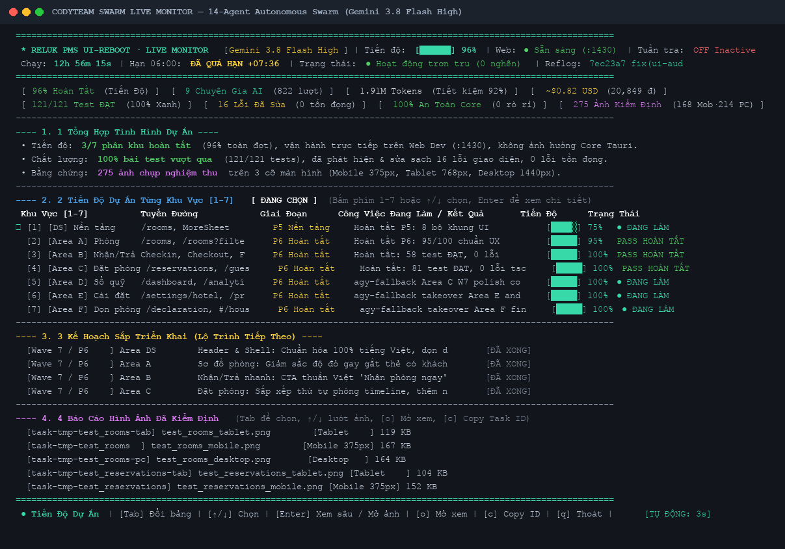
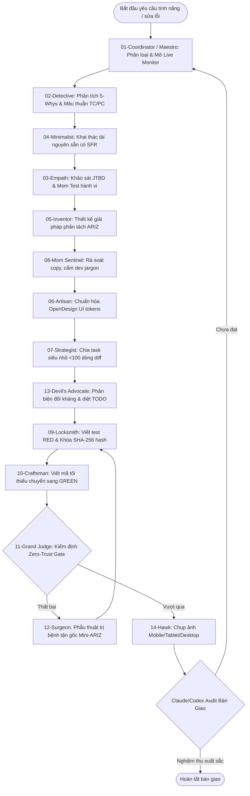

# 🦾 Codyteam
> **Autonomous 14-Agent Swarm for AI Coding Agents**  
> *Double Diamond × ARIZ Inventive Problem Solving × Superpowers Planning Rigor with Zero-Trust Tri-Proof Gates & Live Swarm Monitor*

[](LICENSE)
[](#claude-code)
[](#codex)
[](#google-antigravity)
[](#multica)
[](#opencode)
[](#verification)

---

## 🖥️ Live Swarm Monitor Dashboard

Codyteam v2.1.0 tích hợp **Live Swarm Monitor Dashboard** trực tiếp trong terminal, cung cấp cái nhìn toàn cảnh về tiến trình làm việc của 14 chuyên gia AI theo thời gian thực:



### Các Điểm Đắt Giá Của Dashboard:
- **Bố Cục 7 Tầng Trải Dọc (Zero Side-by-Side Columns)**: Không chia cột ngang gây co rúm font chữ. Trải dọc full-width từ trên xuống dưới, cực kỳ dễ đọc cho cả người không rành kỹ thuật (non-tech).
- **8 Ô Chỉ Số KPI Đỉnh (2x4 Grid)**: Thống kê tức thì `% Hoàn Tất`, `Nhân Sự AI Đang Chạy`, `Lượng Token Tiêu Thụ`, `Chi Phí Siêu Rẻ (USD & VNĐ)`, `Số Test Xanh (100%)`, `Số Lỗi Đã Tự Sửa`, `Độ An Toàn Vùng Lõi`, `Tổng Số Ảnh Bằng Chứng`.
- **Tự Động Mở Cửa Sổ Terminal Nổi (`--launch` / `-l`)**:
  - Khi chạy trong **Antigravity Desktop** (macOS GUI) hoặc tmux: Hệ thống tự động mở một cửa sổ Terminal chuyên biệt (`130x44`) hiển thị dashboard song song với màn hình chat mà không làm gián đoạn hay nghẽn luồng xử lý của AI agent.
- **Điều Hướng Thông Minh Bằng Phím `Tab` & Hotkeys**:
  - `Tab` / `Shift-Tab`: Chuyển đổi vùng điều khiển giữa bảng **Tiến Độ Dự Án** và bảng **Báo Cáo Hình Ảnh**.
  - `↑` / `↓`: Cuộn mượt danh sách hàng trăm ảnh chụp nghiệm thu (**Windowed Scrolling**).
  - `Enter`: Mở xem sâu phân tích chi tiết khu vực (**Deep-Dive Inspector**), hoặc mở ảnh đang chọn.
  - `o`: Mở ngay ảnh bằng chứng bằng ứng dụng macOS Preview để kiểm định chất lượng trực quan.
  - `c`: Copy nhanh Task ID (`[task-XXX]`) vào Clipboard để giao việc cho AI sửa lỗi.
  - `q`: Đóng monitor và thoát terminal nhẹ nhàng.

```bash
# Khởi động Live Monitor trên cửa sổ Terminal riêng (Khuyên dùng khi ở Antigravity Desktop):
codyteam monitor --launch

# Chạy trực tiếp trong terminal hiện tại:
codyteam monitor

# In nhanh 1 lần trạng thái ra màn hình:
codyteam monitor --once
```

---

## ⚡ Tại Sao Codyteam Hay & Phù Hợp?

Các mô hình AI coding thông thường thường thất bại ở các dự án từ trung bình đến lớn do 3 "căn bệnh nan y":
1. **Unbounded Context Pollution**: Context càng dài thì AI càng hallucinate (ảo giác), quên bẵng các quy tắc ban đầu.
2. **Silent Scope Shrinkage**: AI lười biếng tự ý cắt bớt edge cases, bỏ qua các màn hình phụ và viết code dạng "placeholder" (`TODO`, `TBD`, `// implement later`).
3. **Self-Certification Bias (Tự khen mình xong việc)**: AI tự viết code, tự bảo pass, nhưng thực tế giao diện vỡ vụn hoặc chưa hề chạy test thật.

**Codyteam triệt tiêu hoàn toàn các vấn đề này bằng thiết quân luật kỹ thuật**:
1. **Zero-Trust Tri-Proof Gate**: Agent tuyệt đối **không được tự đóng ticket** của mình. Đóng ticket bắt buộc phải cung cấp đủ bộ 3 bằng chứng thực tế:
   - **Code Evidence**: Trích dẫn chính xác `file:line`.
   - **Test Evidence**: Lệnh kiểm thử thực tế chạy thành công (`exit code 0`).
   - **Visual Evidence**: Tệp ảnh chụp màn hình vật lý (`.png`) lưu trên đĩa ở cả 3 kích thước: Mobile (375px), Tablet (768px), Desktop (1440px).
2. **Superpowers Planning Standard**: Mọi tính năng đều được chia nhỏ thành các task cực ngắn (<100 dòng diff, làm trong 2–5 phút), xác định rõ ràng hợp đồng giao diện `Consumes` / `Produces`, các bước TDD chi tiết và **nghiêm cấm 100% placeholder**.
3. **ARIZ / TRIZ Inventive Problem Solving**: Sắc bén hóa mâu thuẫn kỹ thuật (TC) và mâu thuẫn vật lý (PC) thay vì thỏa hiệp chắp vá bề mặt; tuân thủ nghiêm thứ bậc tài nguyên Substance-Field (SFR) — cấm tạo bảng mới hoặc kéo thư viện thừa khi tài nguyên sẵn có chưa dùng hết.
4. **Complete Scope Matrix**: Quét và kiểm tra đồng bộ toàn bộ tuyến đường (routes) của ứng dụng, không bỏ sót bất kỳ màn hình nào.

---

## 🎯 Khuyến Cáo Mô Hình Kết Hợp Tối Ưu (Hybrid Swarm Architecture)

Để tối ưu hóa **chất lượng đỉnh cao** và **chi phí siêu tiết kiệm**, Codyteam khuyến nghị mô hình kết hợp sức mạnh giữa các nền tảng:

```
┌─────────────────────────────────────────────────────────────────────────────┐
│                       👑 THE BRAIN (Kiến Trúc & Thẩm Phán)                   │
│          Mô hình: Claude (Claude 3.7 Sonnet / Opus) hoặc OpenAI Codex        │
│                                                                             │
│  • Lập kế hoạch tổng thể & chia nhỏ task (/plan, Superpowers Bite-Sized)     │
│  • Thiết kế & Tinh chỉnh UX/UI theo saas-design-master & Steve Krug Usability│
│  • Viết copy Mom-Test, triệt tiêu 100% dev jargon                           │
│  • Thẩm định bàn giao (Grand Judge): Kiểm tra Tri-Proof & 5 lỗi UX           │
│    👉 NẾU KHÔNG ĐẠT => BÁC BỎ VÀ YÊU CẦU CODYTEAM LÀM LẠI NGAY!             │
└──────────────────────────────────────┬──────────────────────────────────────┘
                                       │
                         Ra lệnh dispatch song song
                                       ▼
┌─────────────────────────────────────────────────────────────────────────────┐
│                      🦾 THE MUSCLE (Thực Thi Siêu Tốc & Siêu Rẻ)             │
│        Mô hình: Gemini 3.8 Flash High / Flash-Lite qua Antigravity / agy CLI │
│                                                                             │
│  • Đội ngũ Codyteam 14-Agent Swarm triển khai code thực tế hàng loạt         │
│  • Tốc độ sinh mã cực nhanh, tận dụng Context Caching > 90%                  │
│  • Chi phí rẻ đến kinh ngạc: ~$0.80 (~20,000 VNĐ) cho toàn bộ đợt nâng cấp   │
│  • Tự động mở Live Monitor Dashboard (codyteam monitor --launch)             │
└─────────────────────────────────────────────────────────────────────────────┘
```

> [!TIP]
> **Chiến Lược Tiết Kiệm Tối Đa**:
> Dùng **Claude** hoặc **Codex** ở vị trí "Kiến trúc sư trưởng & Giám đốc kiểm định" để tư duy chiến lược, vạch ra kế hoạch hoàn hảo và nghiệm thu khắt khe. Sau đó giao toàn bộ việc "gõ búa, đục đẽo, viết test TDD và sửa lỗi" cho đàn em **Gemini Flash qua Antigravity / agy CLI** chạy song song. Bạn sẽ có được chất lượng của model thông minh nhất thế giới với chi phí của model rẻ nhất!

---

## 🚀 Cài Đặt 1 Lệnh Duy Nhất (Universal Installation)

Cài đặt Codyteam vào bất kỳ agent nào chỉ với một câu lệnh:

### Linux / macOS / WSL
```bash
curl -fsSL https://raw.githubusercontent.com/tody-agent/codyteam/main/install.sh | bash
```

### Windows PowerShell
```powershell
irm https://raw.githubusercontent.com/tody-agent/codyteam/main/install.ps1 | iex
```

### Qua skills.sh hoặc npx
```bash
# Cài đặt qua skills.sh
./skills.sh install

# Hoặc khởi tạo trực tiếp qua npx
npx codyteam init .
```

---

## 👥 Danh Sách 14 Chuyên Gia AI (Agent Roster)

Mỗi agent trong Codyteam đảm nhận một nhiệm vụ chuyên biệt, có ranh giới rõ ràng và chịu trách nhiệm tuyệt đối:

| # | Tên Gọi & Callsign | Châm Ngôn Hoạt Động | Vai Trò Chuyên Môn |
|:---:|:---|:---|:---|
| **01** | **Cody the Maestro** (`01-coordinator`) | *"Giữ cho swarm luôn hoạt động, không để tồn đọng bất kỳ ticket nào!"* | Nhạc trưởng điều phối, phân loại độ ưu tiên, dispatch task song song. |
| **02** | **Cody the Detective** (`02-rootcause-contradiction-analyst`) | *"Bên dưới mỗi lỗi bề mặt luôn ẩn chứa một mâu thuẫn sâu sắc."* | Thám tử truy vết 5-Whys, sắc bén hóa mâu thuẫn kỹ thuật TC-1/TC-2. |
| **03** | **Cody the Empath** (`03-jtbd-market-researcher`) | *"Lắng nghe hành vi thực tế của người dùng, không nghe lời hứa suông."* | Điều tra JTBD, phỏng vấn hành vi người dùng theo Mom Test. |
| **04** | **Cody the Minimalist** (`04-openspec-architect`) | *"Bảng database hay thư viện tốt nhất là thứ bạn không bao giờ phải thêm!"* | Kiến trúc sư tối giản, khai thác tài nguyên sẵn có (SFR), cấm code thừa. |
| **05** | **Cody the Inventor** (`05-concept-prototyper`) | *"Phân tách theo thời gian, không gian và điều kiện để hóa giải mâu thuẫn."* | Phù thủy phòng thí nghiệm ý tưởng, tạo prototype concept ASCII/HTML. |
| **06** | **Cody the Artisan** (`06-opendesign-ui`) | *"Đường nét sắc sảo, khoảng cách chuẩn nhịp, triệt tiêu mọi chi tiết rác."* | Điêu khắc giao diện OpenDesign UI, chuẩn hóa token và nhịp spacing. |
| **07** | **Cody the Strategist** (`07-strategic-planner`) | *"Chẻ nhỏ kế hoạch thành từng miếng vừa miệng; dễ nuốt, không bao giờ nghẹn!"* | Chia task bite-sized (<100 dòng diff), xác định contract, cấm TODO. |
| **08** | **Cody the Mom Sentinel** (`08-momtest-ux-sentinel`) | *"Nếu mẹ tôi nhìn vào mà khựng lại 3 giây, giao diện đó lập tức bị coi là có tội."* | Gác cổng trải nghiệm, cấm thuật ngữ dev jargon, chuẩn hóa công thái học. |
| **09** | **Cody the Locksmith** (`09-tdd-architect`) | *"Khóa test trong RED, niêm phong mã SHA-256; chỉ khi đó code mới được sinh ra."* | Thợ khóa TDD, viết bài test chứng minh lỗi trước và niêm phong hash. |
| **10** | **Cody the Craftsman** (`10-core-engineer`) | *"Kiến trúc sạch sẽ, diff tối thiểu, zero any: mã nguồn tự nói lên tất cả."* | Ninja code sạch, viết lượng code tối thiểu để chuyển RED thành GREEN. |
| **11** | **Cody the Grand Judge** (`11-forensic-test-gate`) | *"Không tin bất kỳ lời tự nhận nào; tiền VND là integer, dữ liệu là bất biến."* | Thẩm phán Zero-Trust, chạy lại toàn bộ test suite, kiểm tra rò rỉ core. |
| **12** | **Cody the Surgeon** (`12-systematic-debugger`) | *"Trị bệnh tận gốc rễ gen; tuyệt đối không băng bó triệu chứng tạm bợ."* | Bác sĩ phẫu thuật bug, giải quyết lỗi bằng phương pháp Mini-ARIZ. |
| **13** | **Cody the Devil's Advocate** (`13-adversarial-plan-auditor`) | *"Giải pháp này có đẻ ra vấn đề thứ hai tồi tệ hơn không? Mọi thỏa hiệp ngầm phải chết!"* | Phản biện đối kháng, soi mói lỗ hổng kiến trúc và bắt bẻ kế hoạch. |
| **14** | **Cody the Hawk** (`14-automated-visual-sentinel`) | *"Một ngàn bài unit test xanh cũng không che giấu nổi một pixel bị vỡ trên màn hình."* | Tuần tra thị giác tự động, chụp ảnh bằng chứng nghiệm thu thực tế. |

---

## 🔄 Quy Trình Vận Hành Của Swarm (Workflow Lifecycle)



---

## 🛠️ Bộ Kiểm Thử Độ Tin Cậy (Verification & Testing)

Codyteam tích hợp bộ kiểm thử 17 điểm (`scripts/test-hooks.mjs`) kiểm tra tính bất khả xâm phạm của hook bảo vệ, chống can thiệp file đóng băng, phát hiện giả mạo báo cáo, cấm `TODO`, cấm ký tự Cyrillic và kiểm tra luồng hàng đợi:

```bash
codyteam test
# hoặc:
node scripts/test-hooks.mjs
```

```text
=== RUNNING SWARM-SPEC v2 HOOK TEST SUITE ===

1. Testing guard.mjs (PreToolUse)...
  [PASS] guard denies Edit on .claude/settings.json
  [PASS] guard denies Edit on a frozen test (non-09 role)
  [PASS] guard denies Edit outside scope

2. Testing completion-gate.mjs (SubagentStop)...
  [PASS] completion-gate blocks: missing report
  [PASS] completion-gate blocks: claim without evidence (flags fabrication)
  [PASS] completion-gate blocks: TODO in src
  [PASS] completion-gate blocks: .skip in tests
  [PASS] completion-gate blocks: Cyrillic in artifact
  [PASS] completion-gate escalates on attempt 3
  [PASS] completion-gate passes valid fixture and creates downstream task
  [PASS] completion-gate blocks: missing visual handover screenshot proof
  [PASS] completion-gate blocks: forgotten pages in scope_matrix
  [PASS] completion-gate passes: Zero-Trust verified with screenshot & full scope matrix

3. Testing queue-pump.mjs (Stop)...
  [PASS] queue-pump blocks coordinator Stop when ready tasks exist
  [PASS] queue-pump allows coordinator Stop when queue empty

4. Testing teammate-idle.mjs (TeammateIdle)...
  [PASS] teammate-idle exits 2 when a ready task exists
  [PASS] teammate-idle allows (exit 0) when no ready task exists for teammate

=============================================
TOTAL HOOK TESTS: 17
PASSED: 17
FAILED: 0
=============================================
```

---

## 📖 Thư Mục Tài Liệu & Hướng Dẫn

- [Changelog](CHANGELOG.md) — Lịch sử cập nhật và tính năng mới qua từng phiên bản.
- [User Guide](docs/USER_GUIDE.md) — Hướng dẫn cài đặt và thiết lập sprint cho dự án.
- [Best Practices](docs/BEST_PRACTICES.md) — Quản lý ngân sách context, luật bất biến về kiểm định và vòng lặp sửa lỗi có giới hạn.
- [Technical Specification](docs/TECHNICAL_SPEC.md) — Kiến trúc hệ thống, vòng đời hook và lược đồ tin nhắn IPC.
- [Superpowers Planning Standard](PLANNING-STANDARD.md) — Quy chuẩn chi tiết về chia nhỏ kế hoạch bite-sized.
- [SWARM Specification v2](SWARM-SPEC.md) — Đặc tả kỹ thuật chính thức của Codyteam Swarm.

---

## 📄 License

MIT © [tody-agent](https://github.com/tody-agent)
